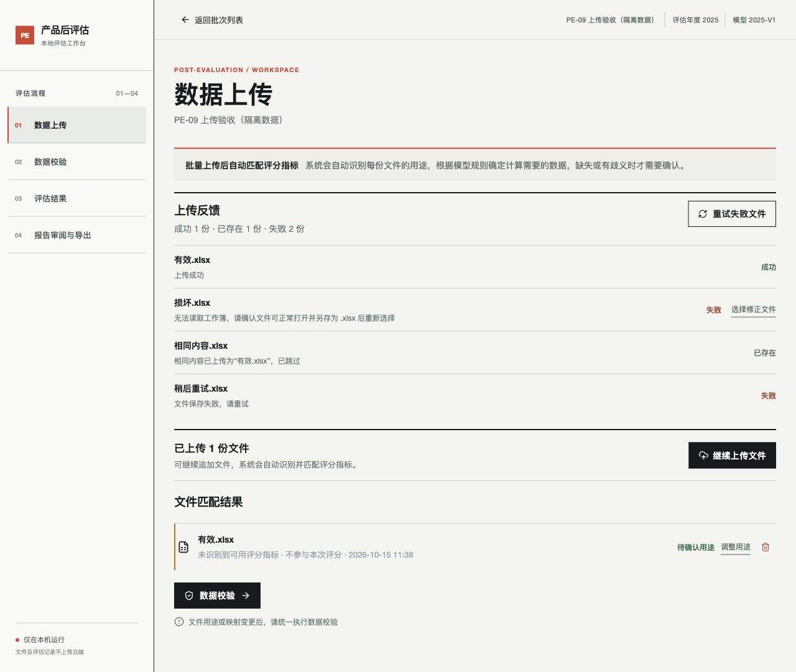
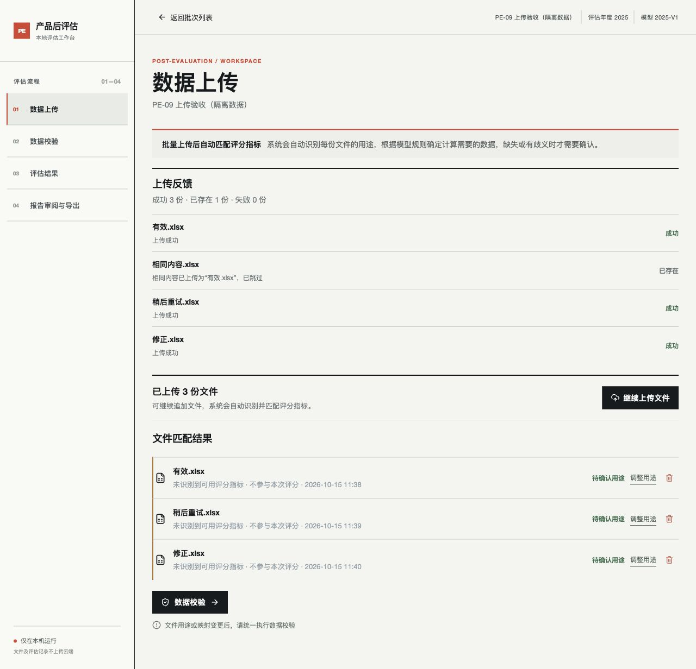
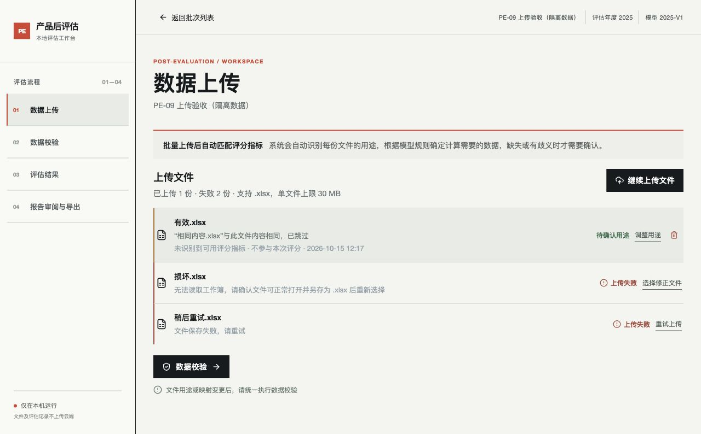

# PE-09：批量上传部分成功反馈

已完成并验收。上传接口按文件返回成功、失败或相同内容已存在，某个文件失败后继续处理后续文件。响应保留原批次字段，并增加仅用于本次请求的 `upload_results`，每项包含输入序号、文件名、状态、原因及是否可重试。

页面以单一“上传文件”列表展示成功文件的匹配信息和失败文件的原因、处理入口。重复上传提示合并到原文件行，不增加重复行。暂时性读写失败可在对应行点击“重试上传”，只重新提交该失败文件；格式损坏、非 xlsx 和超过 30 MB 的文件提示修正后重新选择。响应丢失时重新读取批次，重试由服务端内容哈希检查避免重复保存。

同批次中按内容 SHA-256 识别重复，包括同一请求中的重复和改名重传；保留原文件、用途和映射，反馈原文件名。重复或全失败的请求不会清空已有校验与评分结果。同名但不同内容仍可上传，以便后续显式校验来源冲突。新增成功文件会按原流程使校验和结果失效，仍需用户显式执行数据校验。保存失败时清理本次尚未提交的文件副本。

验证：新增 6 项接口/存储回归测试通过，全量 98 项测试通过，前端构建和差异检查通过。混合有效、损坏、超限、相同内容和暂时保存失败文件，核对逐文件响应、服务端记录和磁盘副本；核对重传不改变已有映射、校验及结果。浏览器在隔离临时数据目录中验证成功文件立即出现、失败重试、修正文件选择及重复跳过，无控制台错误。实际业务批次未用于上传验收。

后续界面调整：上传反馈与文件匹配结果合并为单一列表，重复提示合并到原文件行，失败行直接提供“重试上传”或“选择修正文件”。前端构建通过，浏览器确认一次混合上传展示 1 份已上传、2 份失败，重复文件不新增行；行内重试后变为 2 份已上传、1 份失败。

