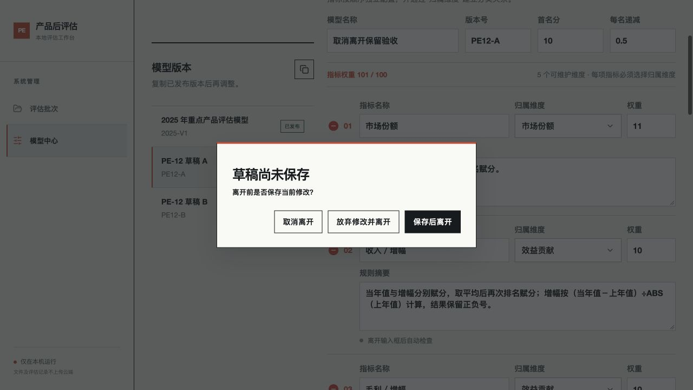
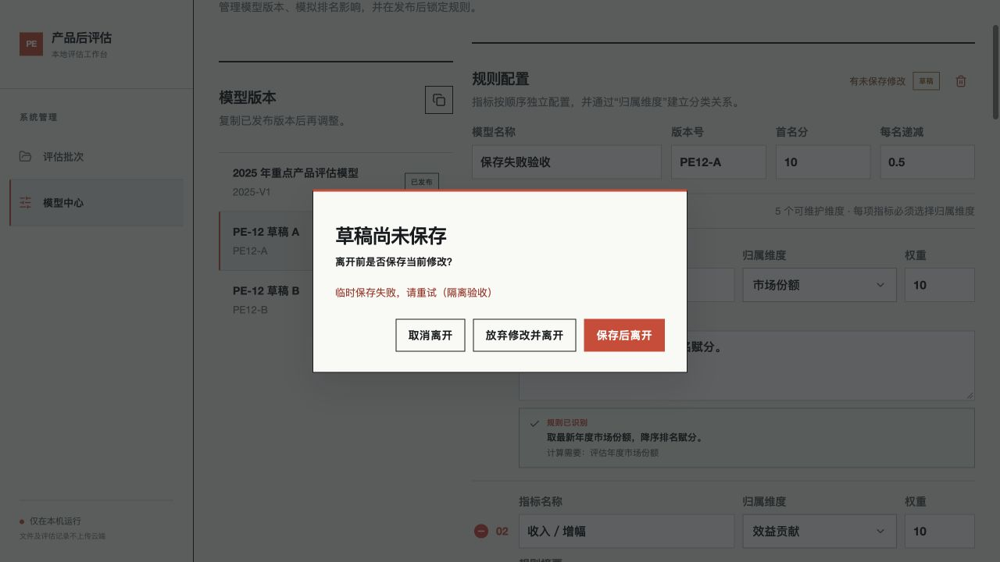
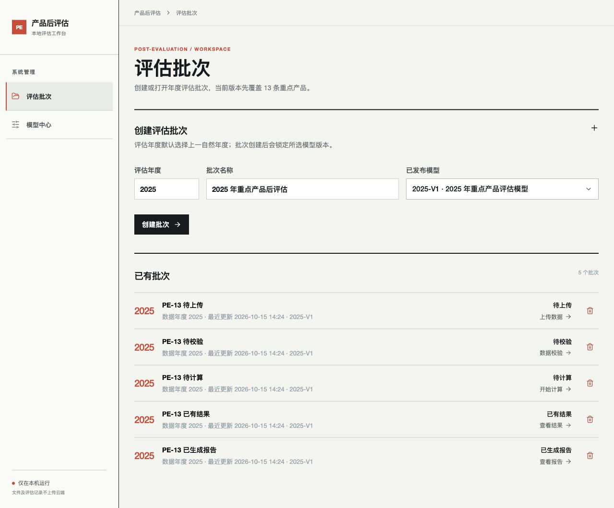

# PE-12、PE-13：草稿保护与批次进度

已实施并在隔离数据中验收。

## PE-12 模型草稿未保存保护

以最后一次从服务端加载或保存成功的配置作为基线，比较名称、版本号、维度、指标顺序、权重、规则摘要和计分参数。自动生成的解析记录、时间戳与解释不计为用户修改；显式声明与原有单指标隐式绑定等价时也不误报。修改后恢复原值即恢复“已保存”。已发布或归档模型保持只读。

切换模型、复制模型或通过导航离开模型中心时，未保存草稿提供“保存后离开”“放弃修改并离开”“取消离开”。保存后离开只保存草稿，不触发发布。保存失败保留当前草稿和离开弹窗，可重试或取消。保存期间禁止切换模型和继续编辑。规则检查进行中需等待完成再保存。刷新/关闭页使用浏览器原生离开提醒；如需保存，应取消原生离开操作后在页面保存。

切换模型的读取请求有生命周期隔离，旧加载响应不会回填当前模型；保存后的变更记录按需重新读取，保留审计展示。

浏览器验收：取消保留名称、11分权重及升序规则；放弃后恢复原名、10分和降序规则；模拟一次保存失败后仍停留原草稿，再次保存成功才切换；通过导航保存离开后重开可恢复；名称/权重/规则改回原值不出现离开弹窗；已发布模型只读。最终构建再次验证11/9权重与升序规则可保存恢复。

## PE-13 批次进度与下一步

由已有文件、校验、结果及当前有效报告推导，列表和详情共用同一个函数，不新增手工维护状态。

| 进度 | 条件 | 进入页面 |
| --- | --- | --- |
| 待上传 | 无结果、无文件 | 数据上传 |
| 待校验 | 有文件、未通过校验 | 数据校验 |
| 待计算 | 校验通过、无结果 | 数据校验，确认后开始计算 |
| 已有结果 | 已计算，未生成当前有效报告 | 评估结果 |
| 已生成报告 | 报告指纹仍与结果及审阅内容一致 | 报告审阅与导出 |

新增来源、修改映射/用途/来源选择导致结果和校验失效时回退为待校验；删除最后一份文件后回退待上传。仅修改已保存审阅文字使报告失效时保留已有结果状态。打开时重新读取最新批次状态。

列表展示已简化为两种状态：有评估结果时显示“已完成”，没有评估结果时显示“待完成”。不再显示“查看结果”“查看报告”等操作引导及箭头。上表的细分状态仅用于内部进入页面判断，不在列表展示。

浏览器逐一核对五种入口与页面标题一致；将已有结果批次的文件用途改为市场份额并保存，返回列表显示待校验，重新进入落点为数据校验。

验证：3项前端配置比较测试、新增4项后端进度测试通过；全量102项后端测试、前端生产构建和差异检查通过。验收数据在临时目录中，实际业务批次未用于写入验收。

