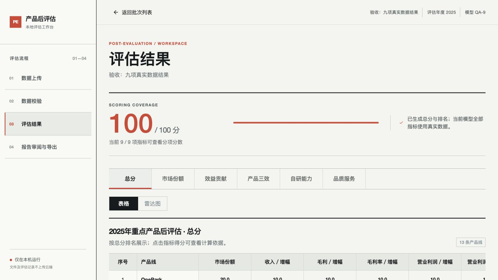
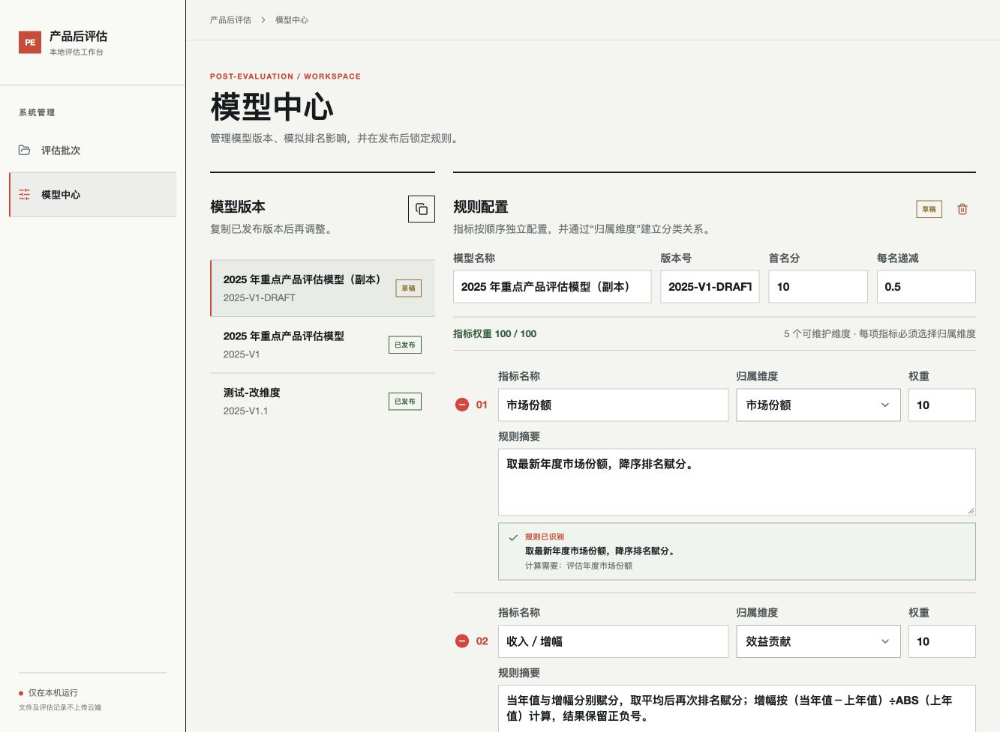
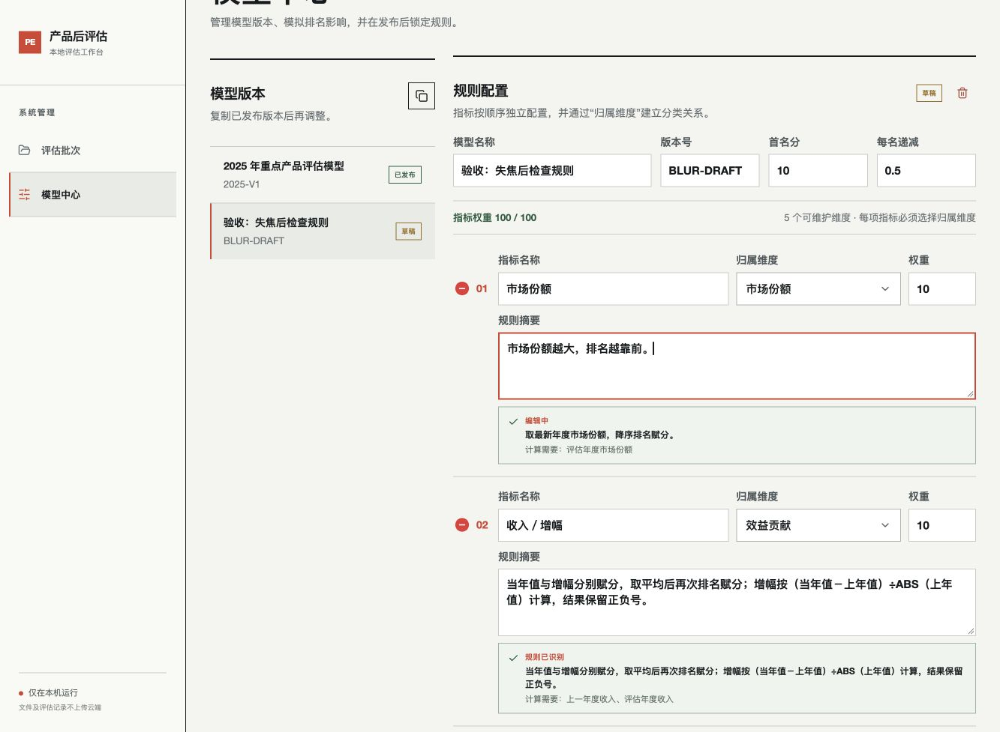
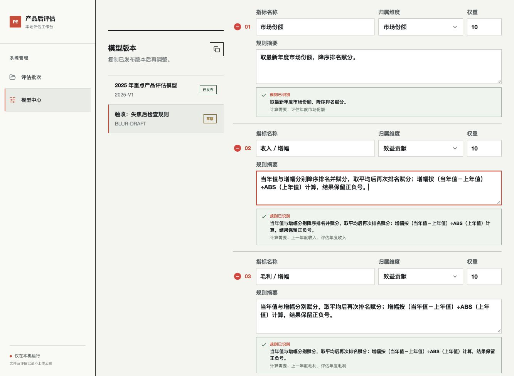
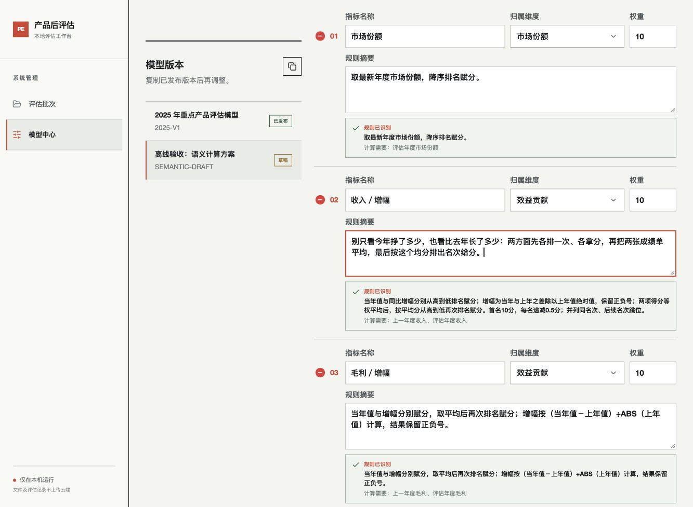
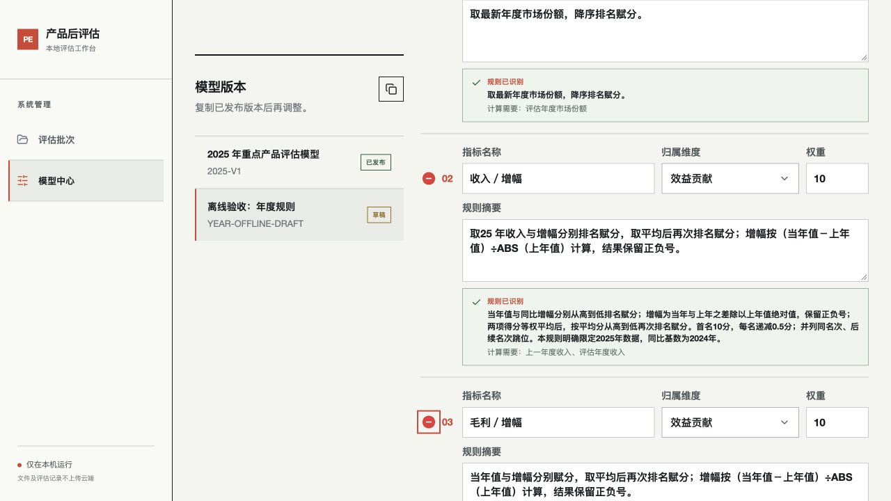
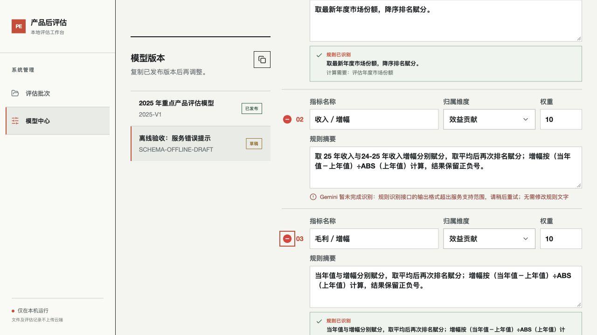

# 模型可执行边界与验收记录

适用任务：PE-01～PE-04。实现于 2026-10-14。

## 发布边界

模型发布由后端检查，前端复用 `/api/models/validate` 的相同判定。空计算标识、未知类型、重复输出、无效数值、未知参数、未支持的计分方式、不明确的排名方向或并列方式、过期解析及未确认的业务口径均不能发布。权重按启用指标合计为100。

草稿可保留尚未识别的摘要；保存也检查计算绑定和参数合法性。旧草稿即使绕过曾经的保存检查，模拟接口仍返回业务错误，不发生除零。发布和计算均使用确定性的支持清单，不执行文本中的表达式。

## 受支持的计算类型

注册信息由 `post_evaluation/calculation_types.py` 提供，包含输入、参数、输出与步骤，通过 `/api/config` 返回给模型中心。新增指标根据业务名称及自然语言摘要自动识别内部来源和计分步骤，获得独立输出标识；界面不展示计算类型选择器。可以复用同一来源，但不同指标的规则和得分互不覆盖。旧模型的已知计算标识可推导相同类型，无须批量改写历史版本。

| 类型 | 原始输入 | 计算步骤 | 参数 |
|---|---|---|---|
| 市场份额 | 评估年度市场份额 | 原值排名、赋分 | 方向、首名分、递减值 |
| 收入／增幅 | 上一年度及评估年度收入 | 当年值与增幅分别排名赋分，平均后再次排名赋分 | 同上、增幅分母是否取绝对值 |
| 毛利／增幅 | 上一年度及评估年度毛利 | 同上 | 同上 |
| 毛利率／增幅 | 上一年度及评估年度毛利率 | 同上 | 同上 |
| 营业利润／增幅 | 上一年度及评估年度营业利润 | 同上 | 同上 |
| 营业利润率／增幅 | 上一年度及评估年度营业利润率 | 同上 | 同上 |
| 产品三效 | 评估年度劳产、元效、人效 | 分别排名赋分，平均后再次排名赋分 | 方向、首名分、递减值 |
| 自研占比／ROI | 自研占比、研发收入及E～K七项成本 | 占比封顶；ROI＝收入÷成本合计；分别赋分，平均后再次排名赋分 | 同上、自研占比封顶百分比 |
| 能力评测（年度模拟） | 按评估年度固定生成占位原值 | 年度模拟值排名赋分 | 方向、首名分、递减值 |
| 品质服务 | 评估年度满意度 | 原值排名赋分 | 方向、首名分、递减值 |

默认口径保留13条重点产品、竞争排名、首名10分、每名递减0.5分。默认经济效益增幅为 `(当年－上年) / ABS(上年)`，保留正负号；零基数阻止计算。默认自研占比100%封顶，ROI不封顶；物联卡和OnePark的原表例外沿用既有读取逻辑。

各计算类型输出原始分、排名、输入来源及中间步骤，再按 `原始分 / 该指标首名分 × 指标权重` 折算贡献。复合指标中的原值按指定升降序排名；最后对平均赋分仍按高分优先排名，避免将表现再次颠倒。规则级首名分与递减值在明确配置时覆盖全局默认值。

## 自然语言与结构化计算方案

2026-10-15 更新：新的 AI 识别协议为 `semantic-plan-v1`，定义在 `post_evaluation/semantic_rules.py`。用户填写自然语言，AI 提取类型明确的计算方案；不再让 AI 输出待执行的公式或自由文本步骤，也不再将用户表述与固定句式逐字比较。

方案包括原始数据及年度、计算策略、原值与最终排序方向、并列处理、赋分参数、平均对象、增幅分母及正负号、占比封顶、真实／模拟来源，以及待澄清问题和未支持能力。后端逐项核对支持范围、完整数据需求、数值边界和计算依赖，再交由原有确定性评分引擎执行。自定义加分、平均原值、非等权平均等不能被强行当成最接近的已支持方案。

成功后页面展示由执行方案及当前模型参数生成的业务说明，而不是照搬 AI 的自由文本摘要。未明确修改的首名分和递减值继承模型设置。计算方案与其原始摘要一起保存；摘要变更后旧方案不能继续发布。

已明确的常见规则继续支持本地识别，无法本地确定的新写法进入 AI 理解；本地未命中不再作为“不支持算法”的依据。无法确认的业务含义返回具体问题。已成功验证的相同内容可复用本进程缓存，缓存最多128项，按版本、指标名称、原始摘要、已有来源提示、模型赋分设置及解析模型隔离；失败结果不缓存，重启后缓存清空。

新方案不执行文字表达式；旧模型保留原有兼容读取路径，不自动升级历史模型、批次、文件映射或数值。本轮没有实现 PE-23 的完整输入／引擎快照。影响模拟仍按已有分项进行权重预演，未保存草稿模拟和规则完整回算分别属于 PE-07、PE-08。

规则摘要在输入期间只更新文字，失焦后才识别，输入时保留提示区域及行高。新识别方案只在草稿内应用，保存或发布后才持久化；不展示内部计算类型选择器。

AI 联网时发送的是本次指标名称、规则摘要、已有来源提示及固定能力目录，不包含上传文件、原始评估数据或模型密钥。用户明确授权后，四条列明样例已完成真实Gemini联调并符合预期；其中两条受支持方案接入本地评分引擎，验证升降序、绝对值分母与负增长保留。离线页面验证使用固定返回样例，真实联网验证及原始方案另见联调记录。

## 覆盖与输出状态

`post_evaluation/result_state.py` 从当前模型及已有分项结果统一生成指标数量、已计算数量、覆盖权重、缺失指标与模拟指标。只有全产品都有该指标的有效分数时才计入覆盖权重；缺失值不补零。

- 分项测算：有缺失指标，总分与排名暂不生成；若已有模拟项也明确标记。
- 试算结果：指标完整，但含年度模拟数据。
- 真实数据结果：当前模型全部指标完整且不含模拟项；权重100分时可输出完整总分。

页面、Excel模型说明表／总分表、DOCX共用状态文字。DOCX评分列、覆盖、图表依据当前指标与加权贡献生成，不再固定取十项。读取旧批次只派生展示状态，不写回分数，也不使已有报告快照失效。

## 验收证据

自动化入口：`python3 -m unittest discover -s tests -v`；构建入口：`frontend/` 中执行 `npm run build`。

最新验收：91项完整测试通过，前端生产构建、Python语法编译及`git diff --check`通过。此前记录的导出表头断言在当前工作区已通过。年度规则的32项定向验收及页面离线证据保留；本轮输出格式兼容性另用已授权样例完成真实Gemini联调。

新增 `tests/test_execution_boundary.py` 与 `tests/test_natural_rules.py` 包括自然语言同义表达、升降序与赋分参数识别、非模板AI解释、旧AI说明兼容，以及：空／未知／畸形配置，布尔值、非有限数及超大整数，无效参数，旧非法草稿模拟，未支持步骤、顺序、公式、并列和时间窗口，离线识别与发布，新增实例绑定真实原表，升降序和竞争排名，首名分／递减／增幅分母／占比封顶参数生效，默认算法与来源追溯，物联卡及OnePark独立原表例外，九项模型与非均等权重、缺失和模拟组合，Excel与DOCX状态一致，以及旧结果／报告读取不改写。

早期浏览器验收使用隔离的临时数据目录与8766端口验证九项模型及发布锁定。计算类型选择器已在后续修正中移除。当前新增指标流程通过隔离API样例验证：自然语言自动识别来源、保存、发布、读取原始数据并按升序计算；未支持的来源与无效参数继续阻止发布。九项模型页面显示9／9项、100／100分和真实数据结果提示。实际项目批次未参与这些写入验收。

自然语言交互修正：移除计算类型字段及其描述，桌面宽度保留指标名称、归属维度、权重同一行，规则摘要另占一行。1333px浏览器验证三项同排，实际草稿10条规则均已识别，发布检查通过；未保存或发布用户草稿。旧AI解析中的数据选择说明、隐含赋分步骤和普通风险提示，不再阻断含义明确的已支持业务规则；新识别记录保存执行契约标识。识别修正只在草稿前端内重查，历史模型和结果不批量写回。

规则输入触发方式修正：规则摘要和待识别指标名称的编辑只更新草稿；失焦后才调用规则识别，并更新模型可执行检查。输入期间保留上一次提示及行高，未检查修改不能发布；过期识别响应不覆盖正在编辑的内容。隔离浏览器验收：连续输入阶段规则请求0次、模型校验请求无新增，相邻两行位置和高度不变；Tab失焦后规则识别1次。前端生产构建通过。

同义规则修正：经济效益规则按原值与增幅分别赋分、平均后再排名的业务子句识别，支持“分别降序排名赋分”“分别降序排名并赋分”“各自从高到低排序然后给分”等同义表述。AI增长率及平均分表达式改为检查数学结构和数据角色，允许等价变量名称与括号形式；保留正负号、分母绝对值、升降序及均等平均的约束不变。对照原始样例验证四种同义写法的所有分项得分及总分排名完全一致；69项测试通过。实际AI联网服务未参与新增自动化测试，AI输出兼容通过受控返回样例验证。

新的 `tests/test_semantic_rules.py` 覆盖自由表述映射同一方案、方案保存／发布／读取、默认十项指标分数及来源追溯保持一致、升降序／分母／封顶／继承模型参数生效、不完整数据和业务歧义的具体反馈、无效参数及未知能力拒绝、成功缓存及失败重试、真实请求载荷与新JSON Schema结构。授权后的真实联网联调已完成，结果见四条样例与验收证据。

真实联网联调结果见 [四条规则样例](semantic-rule-live-checks.md)。

传输协议兼容修正：AI输出不再包含协议版本；服务器在规范化时写入semantic-plan-v1。AI用growth_result的signed_change／absolute_change／not_applicable枚举表达增幅正负号口径，服务器转换为执行字段；字段说明明确区分分母绝对值与整个增幅绝对值。新增回归覆盖了真实模型曾返回version=1.0的情况、否定表达的语义枚举及存储版本检查。79项完整测试与13项协议相关定向测试通过。

年度语义修正：AI传输协议移除独立的time_window预测，服务器从原始输入期间推导年度范围；同比依赖本年及上年，不因出现明确年份而变成单年或自定义窗口。inputs.year保存明确年份（25年规范化为2025年），相对表达保持未指定；相邻输入必须指向同一评估年度。明确年份会显示在实际执行说明中，规则与批次数据年度不符时拒绝计算，避免把2025年规则悄悄应用到2026年数据。旧方案不批量改写，新解释缓存按年度协议修订隔离。

新增四项回归覆盖年度范围派生、完整及简称年份、相对年度、同比相邻关系、2020及2100边界、无效年份，以及规则解析API到实际评分的完整离线链路；32项定向测试通过。隔离浏览器使用截图原句，失焦后显示“规则已识别”及“明确限定2025年数据，同比基数为2024年”。此为固定返回样例的离线验收，不是新样例的真实Gemini识别结果；真实联网复现尚待补充授权，详见 [年度规则联调说明](semantic-year-live-check.md)。

## Gemini输出格式复杂度修正

2026-10-15：截图中的“specified schema ... too many states for serving”表示Gemini在生成前拒绝输出格式，不能视为业务规则含糊。此前将Pydantic的嵌套数组上限、文本长度和数值范围一起发送至服务端；新增年度输入后暴露了格式复杂度限制。Google并未返回具体是哪一个字段超限，不能断言单一字段是唯一原因。

现在生成格式只约束基本结构、必填字段、类型、枚举和是否允许额外属性，简单可空类型统一为type数组；长度、数量、数值范围及业务依赖仍由后端完整Pydantic契约检查。没有退回自由文本执行，没有放松发布或计算边界。相关回归验证了生成格式精简后超长返回、过多输入、无效置信度和业务参数仍被拒绝。

这类HTTP 400服务错误显示中文原因及“无需修改规则文字”，不再直接展示整段服务端英文；其他错误保留脱敏诊断。前端有识别请求错误时不再同时展示“有业务口径待确认”。隔离浏览器已验证失败提示，未保存或发布实际模型。

真实联调复用此前明确授权的四条规则中的第1条，gemini-2.5-flash-lite成功接受简化格式，返回可执行的收入同比方案，排序、得分等权平均、绝对值分母和负增长保留均符合预期。证据：[实际返回](evidence/schema-compatibility-live.json)。此次没有发送截图新增文本；新增年份表达的真实AI语义识别验收仍与接口格式兼容性验收分别记录。

参考：[Google结构化输出文档的复杂度限制](https://ai.google.dev/gemini-api/docs/structured-output#limitations)。

