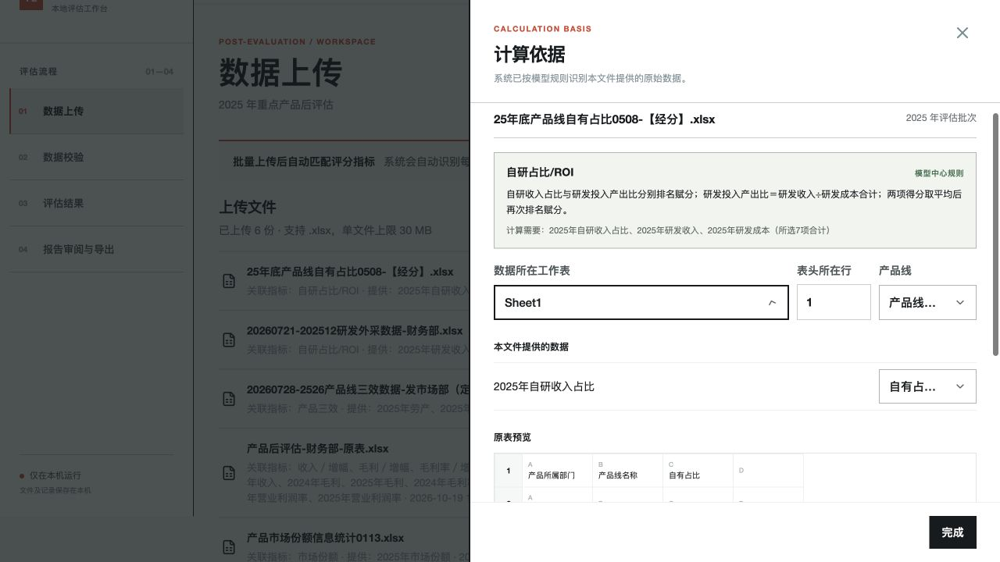

# PE-19：统一弹窗与抽屉键盘行为

已实施，2026-10-30 使用数据库副本验收；未修改实际业务批次或模型。

## 统一约定

- 使用 `frontend/src/modal.ts` 管理初始焦点、Tab / Shift+Tab 循环、Escape、关闭恢复和背景隔离。
- 普通弹窗、抽屉打开时聚焦关闭按钮；删除确认和草稿离开确认聚焦安全的取消按钮。
- 所有可用按钮、输入框、下拉框、链接和可聚焦区域参与循环；禁用、隐藏及 inert 元素不参与。无可用控件时聚焦弹层容器。
- Escape 只作用于最上层。下拉框打开时优先关闭下拉框，下一次才关闭弹层；保存/删除确认正在执行时不允许 Escape 中断。
- 关闭后恢复到仍在页面且可用的触发控件；嵌套层关闭后恢复父层焦点。背景使用原生 inert 隔离，关闭后保留原先的 inert 状态。
- 打开期间锁定页面滚动并拦截背景滚轮/触摸滚动，弹层内部仍可滚动；嵌套层不会提前解除滚动锁。删除此前阻止所有方向键/空格的全局监听，避免阻断控件键盘操作。
- SystemSelect 菜单在所属弹层内挂载，保留固定定位，避免菜单被背景 inert 禁用。

## 覆盖范围与实际验收

| 界面 | 验收结果 |
| --- | --- |
| 影响模拟 | 初始关闭按钮、双向循环、下拉框分层 Escape、回到入口通过 |
| 智能调优 / 变更记录 | 初始焦点、反向循环、Escape、恢复入口通过 |
| 维度管理 | 关闭按钮与保存按钮之间循环、Escape、恢复归属维度下拉框通过 |
| 删除确认 | 初始取消、双向循环、Escape、恢复删除入口通过；未实际删除 |
| 草稿未保存确认 | 初始取消离开、双向循环、Escape、恢复导航入口通过 |
| 评分依据抽屉 | 单个关闭按钮循环、Escape、回到原评分单元格通过 |
| 文件用途抽屉 | 关闭与保存用途之间循环、Escape、回到调整用途按钮通过 |
| 映射依据抽屉 | 输入与选择控件可聚焦、双向循环、下拉框分层 Escape、鼠标关闭恢复入口通过 |

映射抽屉中按 PageDown，背景 `scrollY` 保持 58.5，不带动背景。页面无控制台错误。

## 可重复验证

启动前端 Vite 后访问 `/tests/modal.browser.html`，点击“运行测试”：7 项回归通过，覆盖安全初始焦点、双向循环、忙碌/已处理 Escape、隔离与恢复、嵌套层、无可用控件、重复挂载清理。

另有 3 项原有草稿签名测试通过；前端生产构建及 `git diff --check` 通过。本任务仅改前端交互，不改变计算口径或后台数据结构。

