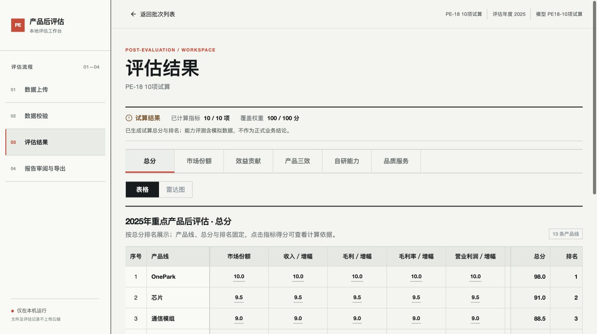
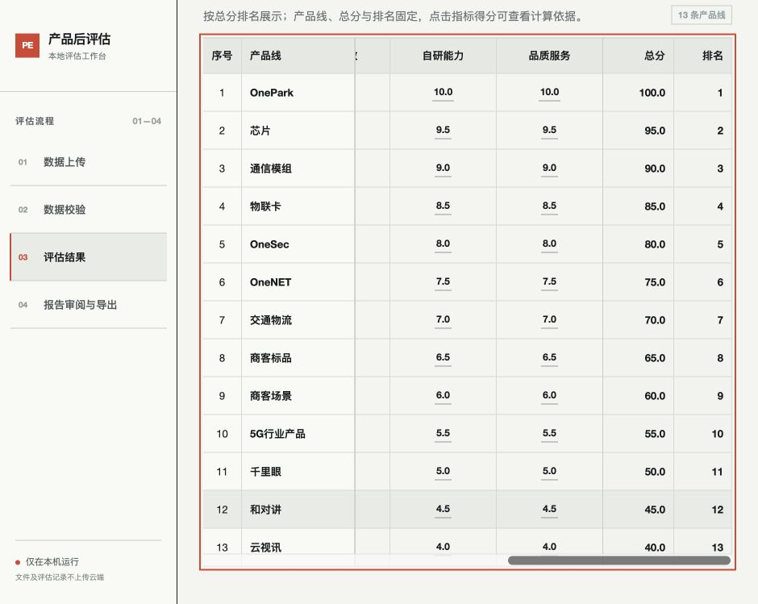

# PE-18：结果页信息密度优化

已完成并验收。顶部以紧凑摘要显示结果状态（完整、试算或分项）、已计算指标数量、覆盖权重及业务说明；含模拟数据或缺少资料的提示保持可见。

总表左侧固定序号和产品线，右侧固定总分和排名，中间保留每项独立指标并横向滚动。表头和数据列使用相同的列宽及冻结位置，背景不透明；行悬停、指标分数计算依据和维度分表继续可用。表格滚动区域支持键盘聚焦与方向键操作。较窄窗口使用较小的固定列宽。

## 验收

在隔离的临时数据目录中，使用真实计算链生成 9 项完整模型、10 项含模拟数据模型，以及缺少市场份额的 9 项分项模型。没有修改实际业务批次或计算口径。

相同高度 749px 下，表格表头距离页面顶部的位置：

| 窗口宽度 | 模型 | 调整前 | 调整后 | 提前 |
| --- | --- | --- | --- | --- |
| 940px | 9 项、10 项 | 736.6px | 586.7px | 149.9px |
| 1333px | 9 项、10 项 | 653.9px | 553.5px | 100.4px |

四种组合均验证横向滚动，产品、总分与排名均位于表格可见区域内，页面本身无水平溢出。总表列数分别为 13 和 14，所有独立指标保留。9 项完整模型显示 9/9 项、100/100 分；10 项试算模型显示模拟数据提示；缺资料模型显示 8/9 项、80/100 分，总分与排名显示待完成。

点击 20.0 分可查看原始赋分与加权贡献；维度表未新增总分冻结列；雷达图保留 13 条产品线。浏览器无控制台错误。6 项现有得分展示及动态覆盖回归测试、前端构建和差异检查通过。

测量记录：`docs/evidence/pe-18-layout-checks.json`。

