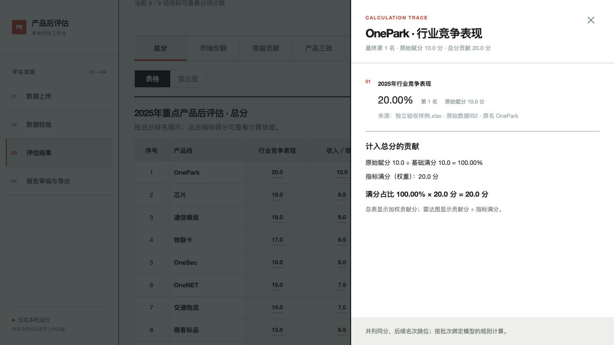
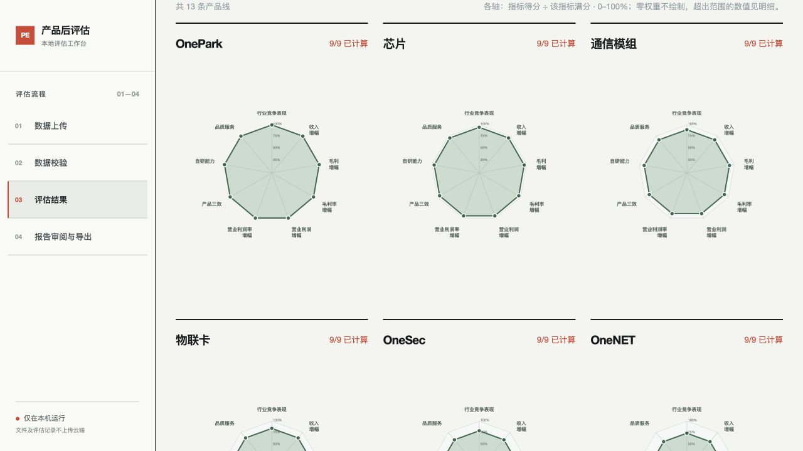

# PE-05、PE-06：得分解释与雷达图口径

已完成并验收。统一数据定义在 `post_evaluation/score_presentation.py`，通过 `describe_result` 提供给结果页；Excel使用相同的字段格式定义。读取旧结果只补充展示数据，不修改存储结果。

每个指标：原始赋分 ÷ 基础满分 × 指标满分（权重）＝总分贡献。雷达图展示总分贡献 ÷ 指标满分，刻度25%、50%、75%、100%。例如原始8.5/10、指标满分20，贡献17分，雷达图85%；基础满分本身为20时也使用实际满分。旧版多子项指标将各子项满分占比取平均后加权。

零权重不绘制雷达轴；缺失数据不补零，也不绘制完整闭合形状；少于3项非零权重指标不绘制雷达图。图形显示范围0–100%，超出范围的真实数值仍保留于明细。

百分比两位小数；原始/加权赋分一位小数；普通数值、金额和ROI两位小数。金额使用来源单位，缺失时标注“单位未标注”；成本合计仅在各成本单位一致时沿用该单位；ROI标为“倍”。显示名称取批次模型，不依赖固定指标名判断格式。

验证：88项全量测试通过；5项新增得分展示测试通过；前端生产构建、Python编译和差异检查通过。浏览器确认10/10×20＝20，20/20与10/10各轴半径相同，19/20与9.5/10同为95%，金额万元、增幅百分比、平均赋分和ROI倍数正确，无控制台错误。验收数据位于隔离临时目录；实际批次未用于写入验收。

